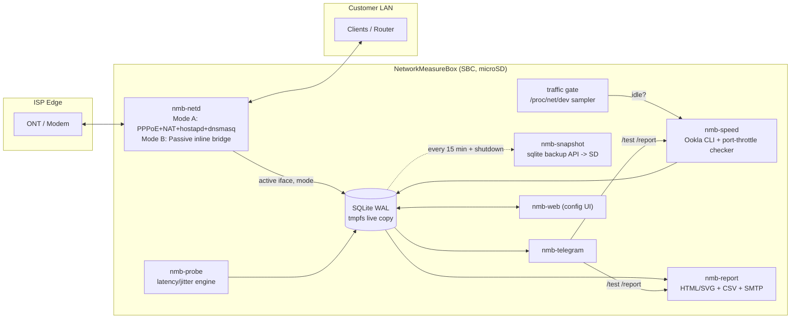

# NetworkMeasureBox (NMB) — Architecture

## 1. System Overview



### Process model
| Daemon            | Phase | Privileges                     | Writes DB |
|-------------------|-------|--------------------------------|-----------|
| `nmb-netd`        | 2     | root (netlink, pppd, bridges)  | events    |
| `nmb-probe`       | 3     | `CAP_NET_RAW` only             | samples   |
| `nmb-speed`       | 3     | unprivileged                   | tests     |
| `nmb-report`      | 4     | unprivileged (timer)           | no        |
| `nmb-telegram`    | 5     | unprivileged                   | alerts    |
| `nmb-web`         | 5     | `nmb` with `CAP_NET_BIND_SERVICE`, `CAP_NET_ADMIN`, `CAP_NET_RAW` | config |
| `nmb-snapshot`    | 1     | unprivileged (timer)           | no        |
| `nmb-collector`   | —     | own user, on the collector's server, not on the box | own database |

Scheduled speed tests are started by a scheduler inside `nmb-web`, driven by `schedule_cron` (hourly by default). There is no separate systemd timer for them.

The traffic gate reads `/proc/net/dev`, so it only sees traffic that passes through the box. The experimental `experimental_stop` switch (off by default) adds `nmb/probe/cross_traffic.py`, which separates other devices' traffic from the box's own using client-side ports or the router's UPnP counters (`nmb/netd/upnp_wan.py`). With it on, a scheduled test stops through `nmb/speed/cancel.py` when that traffic appears, and does not run if the traffic cannot be seen. `nmb-probe` keeps measuring either way.

`nmb-netd`, `nmb-adblock`, `nmb-iperf3`, `nmb-ooni`, `nmb-heal` and `nmb-invasive-log` run as root; `nmb-web` and `nmb-speed` run as `nmb`. `nmb-web` manages services through the rules in `os/90-nmb.rules` and uses `nmb-helper` for other privileged tasks. `nmb-guard` (`os/nmb-guard.nft`) blocks public addresses from the local service ports. Single-writer contention is handled by WAL + `busy_timeout`; probes batch-insert (1 txn / 10 s) so write lock time stays tiny.

### Terminal interface
`nmb-cli` (`nmb/tui/`) offers the WebGUI menus over SSH, and JSON commands for scripts. It reads the menu from `dashboard.html` and calls the same REST API as the browser, so it has no measurement logic of its own. `tests/test_tui.py` fails if a WebGUI tab or API call is missing from its catalog.

### Central collector (`nmb/collector/`)
`nmb-collector` runs on the server of an ISP or a specialist, never on the box. A box whose owner turned on `[collector]` sends, from a thread in `nmb-web` (`nmb/collector/client.py`), everything new since the last successful upload to `POST /api/ingest` with a bearer token: speed tests, hourly ping summaries per target, and its identity (a random `box_uid` from `/var/lib/nmb/box_uid`, the box name, the case number, ISP data). With `share_diagnostics` it adds its events and, hourly, the `llm_bundle` diagnostics report. With `allow_remote_control` it asks `POST /api/poll` every minute for queued commands and reports their results on the next poll; the box runs only `speedtest`, `diagnostics` and `upload`, and both sides refuse anything else. The box only makes outgoing requests. The collector (`nmb/collector/server.py`, standard library) keeps one SQLite file, stores tokens and its admin password as hashes in `collector.json` (0600), and serves search, box pages, diagnostics history, CSV and the command form behind HTTP Basic auth; admin forms must come from its own origin.

### Updates without Git (`nmb/common/updater.py`)
The standard install has no Git data, so `nmb-helper self-update` runs the updater as root from its own copy of the code (`setup.sh` replaces `/opt/nmb` during the update). It downloads the newest commit's archive from GitHub, unpacks it after checking every path, runs its tests, backs up, runs the new `setup.sh` and checks that the web server answers; if not, it puts the previous program files back. Progress is in `/var/lib/nmb/update_status.json`, which the Web UI and `nmb-cli update` poll, since the web server restarts during the install. `/opt/nmb/.source-commit` records the installed commit.

## 2. Storage Strategy (microSD Longevity)

The live database lives in **RAM (tmpfs)**. A consistent snapshot is copied to the SD card
using SQLite's online backup API, **every 15 minutes and when the system shuts down**.

```
              RAM (tmpfs)                         microSD (ext4, noatime,commit=600)
/var/lib/nmb/live/nmb.db  (+ -wal, -shm)  ──backup──▶  /var/lib/nmb/persist/nmb.db
                                           ◀─restore── (when the box boots)
```

- Worst-case data loss on power cut: one snapshot interval (default 15 min).
- SD writes are about 96 sequential snapshot writes per day instead of thousands of small random page writes.
- `/var/log`, `/tmp`, and `/var/tmp` are tmpfs. journald uses `Storage=volatile`.
- Swap is disabled. The ext4 root uses `noatime,commit=600`.

## 3. Directory Layout

```
/opt/nmb/                     # code (read-only at runtime)
  nmb/                        # python package
    db/  netd/  probe/  speed/  report/  bot/  web/
  bin/                        # entry-point wrappers
/etc/nmb/nmb.conf             # INI config (web UI edits this)
/var/lib/nmb/live/            # tmpfs: hot SQLite DB
/var/lib/nmb/persist/         # SD: snapshots + generated reports
/var/lib/nmb/persist/reports/
/run/nmb/                     # tmpfs: pidfiles, sockets, mode state
/var/log/nmb/                 # tmpfs: logs
```

Repository layout mirrors this:
```
nmb/            python package
os/             fstab, journald, sysctl, storage scripts
systemd/        units and timers
config/         default config
docs/
```

## 4. De-Pythonization & Next-Gen Native Architecture

For resource-constrained embedded routers, OpenWrt CPEs (16MB Flash / 32MB–64MB RAM), and multi-gigabit line-rate throughput without Python runtime overhead, refer to the [De-Pythonization Architecture Blueprint](DEPYTHONIZATION_ROADMAP.md), which details the migration of all core engines and merged ecosystem components into a unified static binary (`nmbd`) in **Go** and **C11**.

NMB currently runs only on the Raspberry Pi 4; no router port exists. For the plan covering **ASUS RT-AXE7800**, **ASUS RT-N12+**, **TP-Link TL-WR740N v4.x**, **TP-Link TL-WR1043ND v1.x** and **TP-Link Archer C6 v2.x**, see the [Router Porting & 100% De-Pythonization Specification](ROUTER_PORTING_AND_DEPYTHONIZATION_PLAN.md).

## 5. Telegram Bot Integration & Proactive Automation (`nmb-telegram`)

The `nmb-telegram` daemon runs alongside `nmb-web` to provide mobile chat management and proactive incident alerts without external dependencies (pure Python standard library HTTPS multipart/form-data client).

### Interactive Commands
- **📡 Diagnostics**: `/status`, `/ping`, `/test [ookla|cloudflare|rtr|iperf]`, `/report` (HTML dossier), `/ai` (Markdown bundle), `/mode`
- **🛡️ VPN Hub**:
  - `/vpn` - WireGuard & OpenVPN daemon status and client counts
  - `/vpn clients` - Connected peer roster with IP, latest handshake, and RX/TX traffic
  - `/vpn add <name> [wg|ovpn]` - Creates client peer, automatically dispatches QR code PNG image & `.conf` file
  - `/vpn qr <name>` - Generates and sends QR code image for camera scan pairing
  - `/vpn conf <name>` - Sends downloadable configuration profile
  - `/vpn start [wg|ovpn]` / `/vpn stop [wg|ovpn]` - Daemon process toggles
  - `/vpn del <name>` - Peer revocation
- **🛡️ DNS Ad-Blocker (Pi-hole Sinkhole)**:
  - `/adblock` - Queries today, blocked count, sinkhole %, Gravity domain count
  - `/adblock on` / `/adblock off` - Enable or disable DNS sinkhole
  - `/adblock block <domain>` / `/adblock unblock <domain>` - Custom domain blacklisting and whitelisting
  - `/adblock update` - Background Gravity compilation
  - `/adblock guide` - Home router DHCP DNS setup instructions
- **🩺 Self-Healing**:
  - `/heal audit` - Component health audit
  - `/heal fix [tier]` - Automated repair escalation (Tiers 1–3)
  - `/heal updates` - Verified stable release check
  - `/heal apply` - Atomic update with automatic pre-checkpoint & rollback
- **📊 Tasks & Process Load**: `/tasks` (or `/top`), `/kill <pid> [signal]`
- **📶 Wi-Fi & Guest Wi-Fi**: `/wifi` (telemetry), `/wifi scan` (nearby APs), `/wifi connect <ssid> [pw]`, `/wifi saved`
- **📦 Backups**: `/backup list`, `/backup create [label]`, `/backup send <filename>` (sends `.tar.gz` archive directly in Telegram)
- **🔧 Hardware & Power**: `/drivers`, `/reboot now`

### Proactive Background Alerting (`AlertMonitor`)
Stateful alerts with SQLite deduplication (alert table):
1. **Network Outages**: Triggers when all probe targets become unreachable; alerts on start and resolution with total outage duration.
2. **Rolling Packet Loss**: Triggers when 5-minute rolling packet loss exceeds configured threshold (e.g. 10.0%); resolves when normalized.
3. **Core Daemon Failures**: Proactively monitors `nmb-netd`, `nmb-web`, `nmb-probe`, and `nmb-scheduler`. When a service crashes, alerts the admin and triggers automated Tier 1 self-healing recovery.
4. **Hardware Thermal Overheating**: Proactively reads SoC thermal sensor (`/sys/class/thermal/thermal_zone0/temp`). Warns if temperature exceeds 82°C.
5. **Critically Low Disk Storage**: Warns if available root disk space drops below 500 MB.
6. **Dual-WAN Automatic Failover**: Alerts when primary WAN link fails and traffic fails over to secondary WAN or mobile uplink.


