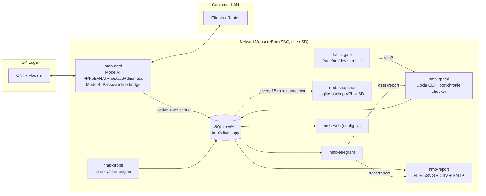

# NetworkMeasureBox (NMB) — Architecture

## 1. System Overview



### Process model
| Daemon            | Phase | Privileges                     | Writes DB |
|-------------------|-------|--------------------------------|-----------|
| `nmb-netd`        | 2     | root (netlink, pppd, bridges)  | events    |
| `nmb-probe`       | 3     | `CAP_NET_RAW` only             | samples   |
| `nmb-speed`       | 3     | unprivileged                   | tests     |
| `nmb-report`      | 4     | unprivileged (timer)           | no        |
| `nmb-telegram`    | 5     | unprivileged                   | alerts    |
| `nmb-web`         | 5     | unprivileged, binds 127.0.0.1/LAN | config |
| `nmb-snapshot`    | 1     | unprivileged (timer)           | no        |

All daemons run as user `nmb`. Single-writer contention is handled by WAL + `busy_timeout`; probes batch-insert (1 txn / 10 s) so write lock time stays tiny.

## 2. Storage Strategy (microSD Longevity)

The live database lives in **RAM (tmpfs)**. A consistent snapshot is copied to the SD card
using SQLite's online backup API, **every 15 minutes and when the system shuts down**.

```
              RAM (tmpfs)                         microSD (ext4, noatime,commit=600)
/var/lib/nmb/live/nmb.db  (+ -wal, -shm)  ──backup──▶  /var/lib/nmb/persist/nmb.db
                                           ◀─restore── (when the box boots)
```

- Worst-case data loss on power cut: one snapshot interval (default 15 min).
- SD writes are about 96 sequential snapshot writes per day instead of thousands of small random page writes.
- `/var/log`, `/tmp`, and `/var/tmp` are tmpfs. journald uses `Storage=volatile`.
- Swap is disabled. The ext4 root uses `noatime,commit=600`.

## 3. Directory Layout

```
/opt/nmb/                     # code (read-only at runtime)
  nmb/                        # python package
    db/  netd/  probe/  speed/  report/  bot/  web/
  bin/                        # entry-point wrappers
/etc/nmb/nmb.conf             # INI config (web UI edits this)
/var/lib/nmb/live/            # tmpfs: hot SQLite DB
/var/lib/nmb/persist/         # SD: snapshots + generated reports
/var/lib/nmb/persist/reports/
/run/nmb/                     # tmpfs: pidfiles, sockets, mode state
/var/log/nmb/                 # tmpfs: logs
```

Repository layout mirrors this:
```
nmb/            python package
os/             fstab, journald, sysctl, storage scripts
systemd/        units and timers
config/         default config
docs/
```
