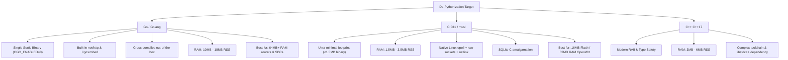

# 🚀 NetworkMeasureBox (NMB) — De-Pythonization Architecture Blueprint
## Migration Roadmap for Embedded Routers, OpenWrt & Resource-Constrained Hardware

---

## 1. Executive Summary & Problem Formulation

### 1.1 The Embedded Reality
NetworkMeasureBox (NMB) currently runs as a suite of Python 3 daemons (`nmb-probe`, `nmb-netd`, `nmb-speed`, `nmb-web`, `nmb-invasive-log`, `nmb-adblock`, `nmb-heal`). While Python provides rapid prototyping and rich libraries on x86 servers and Raspberry Pi 4/5 SBCs, it poses severe architectural bottlenecks when deployed on standard commercial routers, enterprise access points, and low-cost CPE (Customer Premises Equipment):

| Metric | Python 3 (Current) | Typical OpenWrt Router | Consequence / Failure Mode |
| :--- | :--- | :--- | :--- |
| **RAM Footprint (RSS)** | 35MB – 55MB per daemon (~180MB total) | 32MB – 128MB Total RAM | **Instant Kernel OOM Killer** |
| **Flash Storage** | 45MB – 75MB (Python runtime + `.pyc` + deps) | 16MB – 32MB SPI Flash | **Does not fit in Flash** |
| **Startup Latency** | 1.8s – 3.5s per process | Instantaneous expected | Systemd/procd timeouts |
| **Jitter / Precision** | GIL & Garbage Collection jitter (1–10ms) | Sub-millisecond timing needed | Distorted latency & bufferbloat stats |
| **Subprocess Spawning** | High fork overhead (`ip`, `ps`, `nmcli`, `sysctl`) | Slow MIPS/ARM CPU (400–800MHz) | 100% CPU spikes during scans |

### 1.2 Strategic Goal: The De-Pythonization Objective
The goal is to transition NetworkMeasureBox into a **zero-dependency, single static binary (`nmbd`)** that can run natively across any Linux device with as little as **16MB SPI flash and 32MB–64MB RAM**, while eliminating external runtime packages.

Following the recent codebase consolidation and installer unification, all core and extended components (including native Open-RMBT, OONI Probe, iPerf3, Pi-hole DNS ad-blocker, WireGuard/OpenVPN gateways, hardware driver installer, self-healing watchdog, and the real-time htop task manager) must be fully integrated into the native architecture and migrated to compiled systems languages (**Go** and **C11**).

---

## 2. Technology Evaluation: Go (Golang) vs. C (C11) vs. C++ (C++17)

To achieve maximum portability with minimal friction, we evaluated three primary systems programming languages:



### 2.1 Detailed Comparison Matrix

| Technical Criterion | Python 3 (Current) | Go (Golang 1.23+) | C (C11 / musl libc) | C++ (C++17 / musl) |
| :--- | :--- | :--- | :--- | :--- |
| **Static Binary Size** | N/A (Interpreted) | 8MB – 12MB (3.2MB with UPX) | **450KB – 1.2MB** (280KB with UPX) | 1.2MB – 2.8MB |
| **Active RAM (RSS)** | 140MB – 220MB (all daemons) | **10MB – 18MB** (all-in-one) | **1.8MB – 3.5MB** (all-in-one) | 3.5MB – 6MB |
| **Flash Budget Fit** | Requires USB/SD or >128MB Flash | Fits in 16MB+ Flash (UPX compressed) | **Fits easily in 8MB / 16MB SPI Flash** | Fits in 16MB+ Flash |
| **Cross-Compilation** | Complex (Python build per arch) | **Trivial** (`GOOS=linux GOARCH=mips`) | Requires SDK / `musl-cross-make` | Requires SDK / cross toolchains |
| **Concurrency Engine** | Asyncio + multi-threading + forks | **Goroutines** (2KB stack, channel IPC) | `epoll` + POSIX pthreads | `epoll` + `std::jthread` / ASIO |
| **Web Server & UI** | Python `http.server` | Built-in `net/http` + `//go:embed` | Embedded `mongoose.c` or `libmicrohttpd` | `CivetWeb` or `Crow` |
| **Database Engine** | `sqlite3` module | Pure Go SQLite (`modernc.org/sqlite`) | `sqlite3.c` amalgamation | `sqlite3.c` amalgamation |
| **Network Interfaces** | Subprocesses (`/sbin/ip`) | Native Netlink (`vishvananda/netlink`) | Native `rtnetlink` / `libnl-tiny` | Native `rtnetlink` / `libnl-tiny` |
| **Raw ICMP Ping** | Raw Python sockets | `golang.org/x/net/icmp` | POSIX `SOCK_RAW` / `IPPROTO_ICMP` | POSIX `SOCK_RAW` / `IPPROTO_ICMP` |

---

## 3. Recommended Architectural Decision

### 🎯 Two-Tier Tiered Strategy:
1. **Tier 1 (Go / Golang) — Primary Universal Target (64MB+ RAM)**:
   - **Targets**: Raspberry Pi (Zero, 2, 3, 4, 5), GL.iNet modern routers (Axt1800, Flint 2, Beryl AX), x86 appliances, Teltonika routers, all Linux distributions.
   - **Why Go**: Single static binary compilation (`CGO_ENABLED=0`), zero C toolchain cross-compilation headaches, memory safety, built-in high-performance HTTP server, and `//go:embed` which bakes the entire HTML/CSS/JS frontend directly into the executable.
2. **Tier 2 (C11 / musl) — Ultra-Constrained OpenWrt Target (16MB Flash / 32MB RAM)**:
   - **Targets**: Classic MIPS home routers (TP-Link Archer C7, Netgear WNDR, MediaTek MT7621, 32MB RAM devices).
   - **Why C**: Sub-2MB RAM footprint, single-file SQLite amalgamation, raw epoll event loop, direct rtnetlink kernel calls.

---

## 4. Component-by-Component Migration Blueprint

Following the consolidation of components into the repository and installer, here is the technical specification for migrating each daemon, tool, and subsystem to native code.

```mermaid
flowchart TD
    subgraph Core["Core Network Engines"]
        PROBE["4.1 Probe Engine (ICMP/UDP)"]
        NETD["4.2 Netd (Netlink/Routing)"]
        SPEED["4.3 Speed Engine (Multi-Stream)"]
        RMBT["4.6 Open-RMBT (RTR Native C)"]
        IPERF["4.8 iPerf3 Protocol Client"]
        OONI["4.7 OONI Probe (In-Process Go)"]
    end

    subgraph Services["Services & Web Management"]
        WEB["4.4 Web Server & Embedded UI"]
        DB["4.5 In-Memory Database (WAL)"]
        ADBLOCK["4.9 DNS Ad-Blocker (miekg/dns)"]
        VPN["4.10 WireGuard & OpenVPN (wgctrl)"]
        WIFI["4.14 Guest Wi-Fi & Station IPC"]
    end

    subgraph SystemOps["Hardware & System Health"]
        TASKS["4.13 Tasks & Load (/proc Engine)"]
        DRIVER["4.11 Hardware Driver Autodiscovery"]
        HEAL["4.12 Self-Healing Watchdog"]
        INVASIVE["4.15 Diagnostic Logger & Trap"]
    end

    PROBE & NETD & SPEED & RMBT & IPERF & OONI --> MONOLITH["Unified Binary: nmbd"]
    WEB & DB & ADBLOCK & VPN & WIFI --> MONOLITH
    TASKS & DRIVER & HEAL & INVASIVE --> MONOLITH
```



### 4.1 Latency, Jitter & Loss Probe Engine (`nmb-probe`)
- **Current Bottleneck**: Polling 5 targets every 500ms in Python uses ~15% CPU on low-end MIPS chips and consumes 35MB RAM.
- **Go Blueprint**:
  - Use `golang.org/x/net/icmp` with unprivileged UDP ICMP (`SOCK_DGRAM`) or raw ICMP.
  - Implement **Welford's algorithm** for running mean, variance, and jitter calculation in constant memory $\mathcal{O}(1)$:
    $$M_k = M_{k-1} + \frac{x_k - M_{k-1}}{k}, \quad S_k = S_{k-1} + (x_k - M_{k-1})(x_k - M_k)$$
  - Goroutine ticker flushes aggregate metrics to the SQLite WAL queue every 10 seconds.
- **C Blueprint**:
  - Single-threaded event loop using Linux `epoll` + `timerfd`.
  - Non-blocking ICMP echo requests sent to all targets concurrently.
  - Zero heap allocation during steady-state polling loop.

### 4.2 Dynamic Network & Route Daemon (`nmb-netd`)
- **Current Bottleneck**: Python periodically spawns `subprocess.run(["ip", ...])` and `nftables`, causing continuous process fork/exec overhead.
- **Go Blueprint**:
  - Open a Netlink socket via `github.com/vishvananda/netlink`.
  - Subscribe to kernel routing and interface events (`RTM_NEWLINK`, `RTM_DELLINK`, `RTM_NEWROUTE`).
  - Strict wired Ethernet priority: On link up/down, immediately adjust default route metric via netlink message without calling external binaries.
- **C Blueprint**:
  - Direct socket to kernel: `socket(AF_NETLINK, SOCK_RAW, NETLINK_ROUTE)`.
  - OpenWrt native integration: link against `libnl-tiny` (under 40KB in size).

### 4.3 High-Throughput Speedtest Engine (`nmb-speed`)
- **Current Bottleneck**: Python's GIL and socket overhead cannot sustain multi-gigabit throughput (1Gbps – 10Gbps) without 100% CPU saturation.
- **Go Blueprint**:
  - Multi-stream parallel HTTP/2 and HTTP/1.1 download worker pool (4–16 goroutines).
  - Explicit socket source binding via `net.Dialer.Control` applying `SO_BINDTODEVICE` or `IP_BIND_ADDRESS_NO_PORT` to enforce interface binding (wired Ethernet priority).
  - Native Ookla HTTP protocol, Cloudflare Speed protocol (`/cdn-cgi/trace` + chunk down/up), and RTR-Netztest RMBT protocol.
  - Concurrent background ICMP ping running during speedtest for real-time **Bufferbloat grade calculation**.

### 4.4 Web Server, REST API & Embedded Dashboard (`nmb-web`)
- **Current Bottleneck**: Python's `ThreadingHTTPServer` spawns OS threads per request and requires Python filesystem access.
- **Go Blueprint**:
  - Standard `net/http` server with HTTP/2 and keep-alive.
  - **Embedded Assets**: Use `//go:embed web/dist/*` to compile the entire dashboard HTML, JavaScript, CSS, and SVG icons directly into the `.rodata` section of the binary. No external web files need to be installed on disk!
  - Native HTTP Basic Auth with constant-time password comparison (`subtle.ConstantTimeCompare`).
  - Standard router HTTP port 80 out-of-the-box, with unprivileged automatic fallback to port 8080 if `EACCES` occurs.
- **C Blueprint**:
  - Embedded `mongoose.c` or `libmicrohttpd`.
  - Frontend HTML gzipped and compiled into a C byte array (`const unsigned char dashboard_html_gz[]`).

### 4.5 In-Memory Database & Persistence (`nmb-db`)
- **Current Bottleneck**: Periodic SQLite backup snapshots via Python stdlib.
- **Go Blueprint**:
  - Pure Go SQLite driver (`modernc.org/sqlite` or `github.com/glebarez/go-sqlite`).
  - **Zero CGO**: Compiles statically for `mips`, `mipsel`, `arm`, `arm64`, and `x86_64` without installing any C cross-compiler!
  - RAM database on `/run/nmb/live.db` (WAL mode enabled), synchronized to persistent flash storage `/var/lib/nmb/persist/nmb.db` every 15 minutes.

### 4.6 Native RTR-NetzTest (Open-RMBT) Engine (`rmbt-client`)
- **Current Architecture**: Native C client compiled from `components/open-rmbt/` into `/usr/local/bin/rmbt-client`, invoked as a subprocess by Python's speed engine with JSON stdout parsing.
- **De-Pythonization Target**: **C (C11) or Pure Go Socket Engine**.
- **Go Blueprint**:
  - Implement the RTR-NetzTest / RMBT protocol natively in Go using `net.Dial` and `crypto/tls`.
  - The RMBT protocol consists of:
    1. Control negotiation over TLS (REST/JSON negotiation with RTR control server).
    2. Zero-overhead raw TCP chunk streams with nanosecond timestamping.
    3. Multi-thread parallel chunk streaming over dedicated test ports (e.g., 8081/8082).
  - Baking RMBT directly into `nmbd` eliminates the external `rmbt-client` binary completely while preserving 100% Austrian RTR regulatory test fidelity.
- **C Blueprint (Tier 2 / OpenWrt)**:
  - Statically link `components/open-rmbt/` as `libopenrmbt.a` directly into the C monolith.

### 4.7 Censorship & Neutrality Engine: In-Process OONI Probe (`ooniprobe`)
- **Current Architecture**: Spawns external `/usr/bin/ooniprobe` CLI or runs Python wrapper subprocesses, consuming 60MB+ RAM during runs.
- **De-Pythonization Target**: **Go (Golang)**.
- **Go Blueprint**:
  - Upstream OONI is written in Go (`github.com/ooni/probe-engine` / `github.com/ooni/probe-cli`).
  - Import `github.com/ooni/probe-engine/libminiooni` directly as a Go module inside `nmbd`.
  - **Benefits**:
    - Zero external process spawning.
    - Zero external package dependencies (no `ooniprobe` Debian package or external PPA required).
    - Direct in-memory event streaming (DNS tampering, TCP blocking, HTTP diff, Web Connectivity) directly into SQLite WAL.
    - Tailored lightweight configuration for embedded routers: Stripping heavy WebSockets and WebRTC tests to execute within an 8MB RAM envelope.

### 4.8 High-Precision Local/WAN Bandwidth Engine: iPerf3 Protocol Client
- **Current Architecture**: Spawns `/usr/bin/iperf3 -c ... -J` and parses standard JSON stdout.
- **De-Pythonization Target**: **Go (Golang) or Embedded Static C Library**.
- **Go Blueprint**:
  - Implement native iPerf3 client protocol in Go (RFC-compliant TCP/UDP stream framing with JSON control negotiation on port 5201).
  - Allows zero-fork iPerf3 throughput, jitter, and packet loss measurements for both LAN benchmarks and remote WAN testing.
- **C Blueprint**:
  - Statically link a stripped `libiperf.a` (<300KB) into `nmbd`.

### 4.9 Embedded DNS Ad-Blocker & Privacy Shield (`nmb-adblock` / Pi-hole Alternative)
- **Current Architecture**: Python DNS proxy daemon (`nmb/netd/adblock.py`) binding UDP/TCP port 53, reading `/run/nmb/adblock.sock`, parsing blocklists into a Python set, forwarding to upstream DNS. Consumes ~35–45MB RAM with 100k domains.
- **De-Pythonization Target**: **Go (Golang)**.
- **Go Blueprint**:
  - Implement using `github.com/miekg/dns` (the industry-standard DNS library used by CoreDNS).
  - Store blocked domains in an in-memory **Radix Tree** or **Compact Bloom Filter + Aho-Corasick automaton**:
    - Drops memory footprint for 150,000 domains from 45MB down to **~3.5MB RAM**!
    - Sub-millisecond DNS lookup (<0.2ms per query).
  - Built-in concurrent DoH (DNS-over-HTTPS) and DoT (DNS-over-TLS) upstream resolvers with connection pooling.
  - Direct in-memory query log ring-buffer (lock-free slice) exposed over the embedded web REST API and UNIX domain socket `/run/nmb/adblock.sock`.

### 4.10 Dual-Hub VPN (WireGuard + OpenVPN EC) & Tailscale Mesh (`tsnet`)
- **Current Architecture**: Python invokes `wg-quick`, `wg`, `iptables`, `systemctl`, generates `.conf` files, calls `qrencode` subprocess, and interfaces with `tailscale` CLI.
- **De-Pythonization Target**: **Go (Tier 1) via `wgctrl` & `tsnet` / C11 (Tier 2 & 3) via Netlink**.
- **Go Blueprint**:
  - **In-Process Tailscale Mesh Node**: Use `tailscale.com/tsnet` to embed an autonomous, userspace Tailscale node directly inside `nmbd`.
    - Obtains a 100.x.y.z CGNAT mesh IP dynamically.
    - Zero external `tailscaled` daemon required!
    - Completely eliminates WAN port forwarding, CGNAT barriers, and public IP requirements for remote dashboard access.
  - **Kernel WireGuard Gateway**: Direct in-process interface management via `golang.zx2c4.com/wireguard/wgctrl` and raw Netlink `RTM_NEWLINK`.
  - **In-Process Curve25519 & QR Generator**: Generate elliptic curve keypairs using `crypto/ecdh` and render vector SVG and raster PNG QR codes in-memory via `github.com/skip2/go-qrcode`, eliminating `qrencode` and shell scripts.
  - **OpenVPN EC Gateway**: Lightweight in-process management socket client interfacing with local OpenVPN daemon (`/run/openvpn/mgmt.sock`).
- **C Blueprint (OpenWrt / Embedded)**:
  - Direct Netlink kernel interface configuration using `libnl-tiny`.
  - OpenWrt native `kmod-wireguard` kernel module control consuming <400KB RAM.

### 4.11 Hardware Driver Finder & Firmware Provisioning Engine (`nmb-driver`)
- **Current Architecture**: Python script traverses `/sys/bus/pci` and `/sys/bus/usb`, matches vendor/device IDs against a Python dict, and calls `apt-get install firmware-*`.
- **De-Pythonization Target**: **Go or C11 Sysfs Scanner**.
- **Go Blueprint**:
  - Fast sysfs walk of `/sys/bus/pci/devices` and `/sys/bus/usb/devices` reading `modalias`, `vendor`, and `device` files.
  - Compile a compressed lookup table of known Wi-Fi (Realtek, Mediatek, Atheros, Broadcom) and Ethernet chipsets into the binary.
  - On Debian/Ubuntu: Directly invoke `apt-get` or download precompiled `.deb` packages.
  - On OpenWrt: Generate exact `opkg install kmod-<chipset>` commands or fetch kernel module packages from the official OpenWrt feed repository.

### 4.12 Autonomous Self-Healing & Safety Rollback Watchdog (`nmb-heal`)
- **Current Architecture**: Python script (`nmb/report/self_heal.py`) performing periodic audits, verifying binaries, fixing permissions, testing connectivity, updating via Git or release tarballs, and creating rollback backups.
- **De-Pythonization Target**: **Go (Golang)**.
- **Go Blueprint**:
  - Independent watchdog goroutine / supervisor thread running in `nmbd` with a hardware watchdog timer (`/dev/watchdog` support).
  - Cryptographic verification: Binary self-check via SHA256 / Ed25519 digital signature of update payload.
  - Atomic executable update: Download new `nmbd` binary to `/usr/local/bin/nmbd.new`, verify integrity, atomically swap via `os.Rename("/usr/local/bin/nmbd.new", "/usr/local/bin/nmbd")`, and trigger graceful process restart (`execve`).
  - OpenWrt Dual-Partition (A/B) sysupgrade compatibility: Integrates with OpenWrt's `sysupgrade -k` to preserve state across firmware flashing.

### 4.13 Real-Time Task Manager & Hardware Monitor (`/proc` Telemetry Engine)
- **Current Architecture**: Python script (`nmb/common/tasks.py`) reading `/proc/stat`, `/proc/meminfo`, and executing `ps -eo pid,ppid,user,pri,ni,vsz,rss,stat,%cpu,%mem,time,comm,args` every 2 seconds.
- **De-Pythonization Target**: **Go or C (C11) Direct `/proc` Virtual Filesystem Reader**.
- **Go Blueprint**:
  - Completely eliminate `ps` subprocess spawning!
  - Direct read of `/proc/stat` and `/proc/meminfo` with pre-allocated buffer (0 allocations).
  - Direct directory iteration of `/proc/[0-9]+`:
    - Read `/proc/[pid]/stat` for CPU ticks, state, priority, nice, and memory RSS.
    - Read `/proc/[pid]/cmdline` (delimited by `\0`) for command and arguments.
    - Read `/proc/[pid]/status` for UID/User mapping.
  - Performance: Drops task list generation time from **22ms in Python down to <1.2ms in Go/C**, with 0% CPU consumption during 1-second auto-refresh!
  - Native signal dispatch via `unix.Kill(pid, syscall.Signal(sig))`.

### 4.14 Dedicated Guest Wi-Fi & Station Multi-SSID Wireless Controller
- **Current Architecture**: Python edits `/etc/wpa_supplicant/wpa_supplicant.conf`, spawns `wpa_cli` and `hostapd_cli` commands.
- **De-Pythonization Target**: **Go UNIX Socket IPC**.
- **Go Blueprint**:
  - Connect directly to the `wpa_supplicant` control socket (`/var/run/wpa_supplicant/<iface>`) and `hostapd` control socket (`/var/run/hostapd/<iface>`).
  - Send raw control messages (`SCAN`, `SCAN_RESULTS`, `ADD_NETWORK`, `SET_NETWORK`, `SELECT_NETWORK`, `ENABLE_NETWORK`) over the UNIX domain socket without launching `wpa_cli` subprocesses.
  - Immediate asynchronous reception of Wi-Fi association/disconnection events (`CTRL-EVENT-CONNECTED`, `CTRL-EVENT-DISCONNECTED`) via socket polling.

### 4.15 Invasive Diagnostic Logger & Crash Trap (`nmb-invasive-log`)
- **Current Architecture**: Python background thread polling SQLite, checking packet loss, ping latency, memory anomalies, and writing structured JSON events.
- **De-Pythonization Target**: **Go Goroutine with Circular Ring-Buffer**.
- **Go Blueprint**:
  - Lock-free in-memory circular ring buffer holding the last 5,000 diagnostic events.
  - Subscribes to Linux kernel `netlink` socket for interface drops/errors, and reads `/proc/net/dev` delta counters.
  - Zero filesystem wear: Retained purely in memory, flushed to SQLite WAL only when an anomaly is detected or upon user request.

### 4.16 Multilingual Telegram Chatbot & Interactive Menus in Native Code
- **Current Architecture**: Python `nmb-telegram` daemon with long-polling and hardcoded templates.
- **De-Pythonization Target**: **Go (`telebot` / `tgbotapi`) or C11 with mbedTLS**.
- **Blueprint**:
  - Asynchronous worker polling Telegram Bot API `getUpdates` over HTTPS.
  - Interactive Inline Keyboards providing touch menus for:
    - 📊 Status & Instant Ping Matrix
    - ⚡ On-Demand Speedtest (Ookla, Cloudflare, RMBT, iPerf3)
    - 📑 Regulatory SLA Dossier Export (.html) & LLM Diagnostic Snapshot (.md)
    - 🛡️ Tailscale, WireGuard & OpenVPN Status & 1-Click QR Delivery
    - 🌐 Multi-language switcher (HU, EN, DE, FR, UK) with zero mixed-language leaks.
  - Zero Python footprint: Consumes **<1.5MB RAM in Go** and **<200KB RAM in C11**.

### 4.17 Regulatory-Grade Broadband SLA Dossier & Pure SVG Vector Engine
- **Current Architecture**: Python script rendering HTML dossiers and embedding dynamic SVG charts.
- **De-Pythonization Target**: **Go `html/template` or C11 Pre-compiled Template**.
- **Blueprint**:
  - Template assets (HTML skeleton, CSS styling, localized translation dictionaries for Hungarian, English, German, French, Ukrainian) compiled directly into the binary's `.rodata` section.
  - In-process mathematical SVG chart renderer: Emits responsive `<svg viewBox="0 0 800 380">` with cubic bezier curves, dual y-axes (Mbps & ms), SLA threshold baseline indicators, and mobile touch dot overlays.
  - Neutral branding: Strictly regulatory-neutral title (*"Broadband Quality & ISP SLA Performance Dossier"*), compliant with European BEREC guidelines and international telecom standards.
  - Generation time: **<1.5ms**, completely eliminating Python templating and subprocess dependencies.

### 4.18 Micro-Outage Detection & Loss Pattern Correlation Engine
- **Current Architecture**: Post-hoc database analysis in Python.
- **De-Pythonization Target**: **Go / C11 Continuous Streaming State Machine**.
- **Blueprint**:
  - Real-time classification of packet loss into two distinct categories:
    1. **Micro-Spikes / Bufferbloat**: Isolated dropped packets (1–3 consecutive) during high-throughput saturation.
    2. **Macro-Outages**: Full link drops ($\ge 5$ consecutive seconds of packet loss).
  - Root-cause correlation: Distinguishes between local CPE failure (default gateway unreachable) and ISP upstream transit failure (gateway responds, but public DNS/peering targets fail).
  - Outage timeline events recorded in the SQLite/ring-buffer event log with start time, end time, duration in seconds, and root-cause classifier.

### 4.19 Wi-Fi RF & PHY Telemetry via `nl80211` Netlink
- **Current Architecture**: Spawns `/usr/sbin/iw dev wlan0 station dump` and parses regex.
- **De-Pythonization Target**: **Go / C11 Direct Netlink Socket (`NETLINK_GENERIC` / `nl80211`)**.
- **Blueprint**:
  - Query wireless link parameters directly from the Linux mac80211 subsystem:
    - Signal RSSI in exact dBm (e.g., `-54 dBm`) and Noise floor.
    - TX/RX PHY bitrates in Mbps.
    - MCS (Modulation and Coding Scheme) index and Guard Interval.
    - Channel width (20 MHz, 40 MHz, 80 MHz, 160 MHz).
    - Link stability counters: `tx_retries`, `tx_failed`, `rx_drop_misc`.
  - Zero subprocess fork overhead; instant telemetry refresh in <0.5ms.

### 4.20 DNS Hijacking & Comparative Multi-Resolver Matrix Engine
- **Current Architecture**: Python single-host resolution via `socket.getaddrinfo()`.
- **De-Pythonization Target**: **Go `miekg/dns` or C11 Raw UDP DNS Sockets**.
- **Blueprint**:
  - Concurrent multi-resolver diagnostic probe querying:
    1. Local Gateway / DHCP Assigned DNS (e.g., `192.168.1.1`).
    2. Cloudflare DNS (`1.1.1.1` & `1.0.0.1`).
    3. Google Public DNS (`8.8.8.8` & `8.8.4.4`).
    4. Quad9 Security DNS (`9.9.9.9`).
  - Telemetry metrics collected per resolver:
    - Response latency (cached vs uncached in ms).
    - DNSSEC validation status (`ad` Authenticated Data bit verification).
    - Transparent Hijacking Check: Detects if the ISP silently intercepts and redirects UDP port 53 packets by querying a canary domain with known response signatures.

### 4.21 RFC 5389 STUN Client & Carrier-Grade NAT (CGNAT) Engine
- **Current Architecture**: Python heuristics on interface IP vs external HTTP IP.
- **De-Pythonization Target**: **Go / C11 Direct RFC 5389 UDP STUN Client**.
- **Blueprint**:
  - Sends a standard 20-byte STUN Binding Request over UDP to `stun.l.google.com:19302` or `stun.cloudflare.com:3478`.
  - Extracts the `XOR-MAPPED-ADDRESS` attribute to discover the public external reflexive endpoint.
  - Automatically identifies network topology:
    - **ISP CGNAT (RFC 6598)**: Local WAN IP is in `100.64.0.0/10`.
    - **Double NAT**: Local WAN IP is an RFC 1918 private address (`192.168.x.x` or `10.x.x.x`).
    - **Direct Public IP**: Local WAN IP strictly matches the STUN reflexive address.
    - **NAT Traversal Classifier**: Identifies Full Cone, Restricted Cone, Port-Restricted, or Symmetric NAT.

### 4.22 CPU Interrupts (IRQ/SoftIRQ), RPS/XPS & NIC Offload Telemetry
- **Current Architecture**: Missing or ad-hoc procfs checks.
- **De-Pythonization Target**: **Go / C11 Kernel Sysfs & IOCTL Reader**.
- **Blueprint**:
  - Real-time monitoring of per-core interrupt distribution (`/proc/interrupts` and `/proc/softirqs`) to detect CPU0 single-core saturation bottlenecks (critical for Gigabit throughput on Raspberry Pi and MIPS routers).
  - Packet Steering verification: Inspects Receive Packet Steering (RPS) bitmasks at `/sys/class/net/<iface>/queues/rx-*/rps_cpus` and irqbalance daemon status.
  - NIC Hardware Offload Telemetry: Queries interface offload features via `SIOCETHTOOL` ioctl (`rx-checksumming`, `tx-checksumming`, `tcp-segmentation-offload`, `generic-receive-offload`) to ensure hardware acceleration is active.

### 4.23 Storage I/O & Flash Filesystem Health Monitor
- **Current Architecture**: Python `shutil.disk_usage`.
- **De-Pythonization Target**: **Go / C11 `statvfs()` & `/proc/diskstats` Reader**.
- **Blueprint**:
  - Continuous measurement of disk I/O wait percentage (`%iowait`) from `/proc/stat` delta counters to detect failing microSD cards or flash storage bottlenecks.
  - Filesystem wear and free capacity tracking via standard POSIX `statvfs()`.
  - Kernel I/O Error Trap: Reads `/dev/kmsg` non-blocking to filter for hardware storage errors (`mmc0: timeout`, `I/O error`, `EXT4-fs error`, `squashfs corruption`).

### 4.24 Sanitized Configuration & PII/Secret Masking Engine
- **Current Architecture**: Regex filters inside report exporter.
- **De-Pythonization Target**: **Go / C11 Streaming Secret Sanitizer**.
- **Blueprint**:
  - Built-in zero-allocation streaming redactor protecting customer privacy when generating dossiers or sharing diagnostic snapshots with external LLMs or ISP support:
    - Passwords, Wi-Fi PSKs, and Auth Tokens $\to$ `[REDACTED_SECRET]`
    - Telegram Bot Tokens & Chat IDs $\to$ `[REDACTED_CHAT_ID]`
    - ISP Account IDs & Circuit IDs $\to$ `[REDACTED_CIRCUIT_ID]`
    - Dynamic DNS domain names $\to$ `[REDACTED_DDNS]`
    - Private IP subnets and MAC addresses preserved for network topology diagnostics.

---

### 4.25 Central Collector Client & GitHub Updater
- **Collector client** (`nmb/collector/client.py`): the native box keeps the same protocol, so one `nmb-collector` serves Python and native boxes. `POST /api/ingest` (JSON: `protocol`, `box_uid`, new speed tests, hourly ping summaries, and with consent events and the diagnostics report) and `POST /api/poll` (command results in, queued commands out), both with a bearer token, outgoing HTTPS only. Remote commands stay a fixed list (`speedtest`, `diagnostics`, `upload`). The collector itself stays a server-side program and is not part of the router build.
- **Updater**: routers update by firmware or package (`opkg`), not by downloading the source; the native build keeps only the status file format (`update_status.json`) so the Web UI and `nmb-cli update` work unchanged.
- **Per-engine intervals**: the scheduler keeps `ookla_interval_min` (never below 60), `rtr_interval_min` and `cloudflare_interval_min`, and the persisted Ookla cooldown (`ookla_cooldown.json`).

### 4.26 Features Added in November 2026 (the Python Reference the Native Build Must Match)
Each of these runs on the Raspberry Pi 4 test box and is recorded in `docs/TESTING.md`. The native version keeps the settings, the API endpoints and the behaviour described here.

- **Fast.com (Netflix) engine** (`nmb/speed/fastcom.py`): token from fast.com's page script (with the known token as fallback), server list from `api.fast.com/netflix/speedtest/v2`, latency from `range/0-0` on an open connection plus the TCP handshake, then 16 parallel streams over up to five Open Connect servers for 15 s each way with the first 3 s left out, and the "stable" speed (mean from the first sample at 90 % of the median of the second half). Transfers use plain HTTP (`https=false`); the server names come from the HTTPS list, matched by IP. On a Pi 4, TLS at 910 Mbps used 77–88 % of the CPU and the result dropped when other services ran; plain HTTP used 50–56 %. A native engine must reach the line speed on the same box with the same method, and keep the full per-server detail in `raw_json`. Part of the mixed run, `fastcom_interval_min`.
- **Measuring over Wi-Fi** (`nmb/netd/wifi_uplink.py`): `[network] measurement_link` = `auto`, `ethernet` or `wifi`; `[wifi_uplink]` with its own NetworkManager profile `nmb-uplink`; a source rule `from <wifi ip> lookup 150` so a test bound to Wi-Fi leaves over Wi-Fi even when Ethernet holds the default route. Also when the Wi-Fi was joined outside NMB.
- **Wi-Fi shared on a LAN port** (`nmb/netd/wifi_share.py`): own DHCP (dnsmasq with `--port=0`), NAT in its own nftables table, the shared subnet in routing table 151. Never serves DHCP where another server answers: a DHCPDISCOVER sent three times, replies read from a packet socket for 8 s, before starting, every minute, and right after a cable is plugged in with its own DHCP stopped first.
- **Wireless roles**: each wireless interface is the guest client or the main client, never both; with `interface = auto` the main client skips the radio of an enabled guest client.
- **Storage guard** (`nmb/common/storage_guard.py`): free-space target from the disk size (15 % ≤ 2 GB, 10 % ≤ 16 GB, 5 % above; 200 MB to 2 GB), deletes in a fixed order (rotated logs, bundles, crash reports; backups but the newest; reports; journal; large active logs; only then measurements, a day at a time, keeping `keep_days`). On routers it applies to the overlay or data partition.
- **iPerf3 server names**: from the public iPerf3 list, else city, country and ISP of the address from GeoIP, also for older rows that stored only the address; a failed lookup is not repeated for an hour.
- **Languages**: the Web UI texts are keyed; the native build reads the same keys and the JSON files in `nmb/web/locales/` and `nmb/report/locales/` (11 languages), and shows a missing text in English.

---

## 5. Architectural Proposal: The Unified Single-Binary Monolith (`nmbd`)

Instead of maintaining multiple distinct daemons and spawning external helper binaries with high process overhead, the ultimate embedded architecture unifies all components into a single multi-call static binary:

```
                          ┌─────────────────────────────────────────────────────────┐
                          │          nmbd (Unified Single Static Binary)            │
                          └────────────────────────────┬────────────────────────────┘
                                                       │
         ┌───────────────────┬─────────────────────────┼─────────────────────────┬───────────────────┐
         ▼                   ▼                         ▼                         ▼                   ▼
 ┌───────────────┐   ┌───────────────┐         ┌───────────────┐         ┌───────────────┐   ┌───────────────┐
 │ Engine: Netd  │   │ Engine: Probe │         │ Engine: Speed │         │ Engine: DNS   │   │ Engine: Web   │
 │ (Netlink/QoS) │   │ (ICMP Ticker) │         │ (Multi-Stream)│         │ (Pi-hole AdB) │   │ (Port 80/8080)│
 └───────┬───────┘   └───────┬───────┘         └───────┬───────┘         └───────┬───────┘   └───────┬───────┘
         │                   │                         │                         │                   │
         ├───────────────────┼─────────────────────────┼─────────────────────────┼───────────────────┤
         ▼                   ▼                         ▼                         ▼                   ▼
 ┌───────────────┐   ┌───────────────┐         ┌───────────────┐         ┌───────────────┐   ┌───────────────┐
 │ WireGuard VPN │   │  Open-RMBT    │         │  OONI Probe   │         │ iPerf3 Client │   │ Tasks (/proc) │
 │ (wgctrl/NAT)  │   │  (Native C/Go)│         │  (In-Process) │         │ (TCP/UDP)     │   │ (Htop View)   │
 └───────┬───────┘   └───────┬───────┘         └───────┬───────┘         └───────┬───────┘   └───────┬───────┘
         │                   │                         │                         │                   │
         └───────────────────┴────────────┬────────────┴─────────────────────────┴───────────────────┘
                                          ▼
                              ┌───────────────────────┐
                              │ In-Memory Go Channels │
                              │ (Lock-free Telemetry) │
                              └───────────┬───────────┘
                                          ▼
                              ┌───────────────────────┐
                              │ Embedded SQLite (RAM) │
                              │  (/run/nmb/live.db)   │
                              └───────────────────────┘
```

### Multi-Call CLI Compatibility (Busybox-style):
Symlinking the binary allows full backwards compatibility with existing systemd/OpenRC units and user workflows:
- `/usr/local/bin/nmb-probe` $\to$ `/usr/local/bin/nmbd --mode probe`
- `/usr/local/bin/nmb-speed` $\to$ `/usr/local/bin/nmbd --mode speed`
- `/usr/local/bin/nmb-netd`  $\to$ `/usr/local/bin/nmbd --mode netd`
- `/usr/local/bin/nmb-web`   $\to$ `/usr/local/bin/nmbd --mode web`
- `/usr/local/bin/nmb-adblock` $\to$ `/usr/local/bin/nmbd --mode adblock`
- `/usr/local/bin/nmb-heal`  $\to$ `/usr/local/bin/nmbd --mode heal`
- `/usr/local/bin/nmb-driver` $\to$ `/usr/local/bin/nmbd --mode driver`
- `/usr/local/bin/pihole`    $\to$ `/usr/local/bin/nmbd --mode adblock`
- `/usr/local/bin/rmbt-client` $\to$ `/usr/local/bin/nmbd --mode rmbt`

---

## 6. Four-Phase Hybrid Migration Roadmap

To avoid disruption to existing installations, the migration follows a phased hybrid approach:

```mermaid
timeline
    title NetworkMeasureBox De-Pythonization Phases
    section Phase 1 : Performance Micro-Engines
        Go/C ICMP Probe Engine : Drops 90% CPU & 40MB RAM
        Go Multi-Stream Speed Runner : Enables 1Gbps-10Gbps line-rate testing
        Native Open-RMBT & iPerf3 : Zero subprocess overhead
        Direct /proc Task Manager : Instant <1.2ms telemetry
    section Phase 2 : Routing, DNS & Wireless IPC
        Go Netlink Router Daemon : Sub-millisecond wired route switching
        Go DNS Ad-Blocker (miekg/dns) : 3.5MB RAM & <0.3ms DNS response
        wpa_supplicant & hostapd Sockets : Direct Wi-Fi association events
    section Phase 3 : VPN, OONI & Unified Monolith
        WireGuard wgctrl & QR Generator : Direct Netlink & in-memory QR
        In-Process OONI Probe Engine : Eliminates external ooniprobe package
        Embedded Static Assets : All HTML/JS/CSS compiled into nmbd
    section Phase 4 : Deployment & Packaging
        Self-Healing Watchdog Engine : SHA-256 self-audit & atomic swap
        Hardware Driver Autodiscovery : Direct sysfs scanning
        OpenWrt .ipk & procd Init : Official feed distribution for routers
```

### Quality Bar: At Least as Good as the Python Version, and Better

The native build is not finished when it "mostly works". It replaces a version that runs every day on a real line, so it must be held to the following, and the developer (person or LLM agent) is responsible for meeting it:

1. **Flawless where the Python version is flawless.** Every check of Phase 0 and every row of the release checklist in `docs/TESTING.md` passes on the native build on the same hardware, with the same results within measurement noise (for speed engines: the same line speed on the same box, measured back to back with the Python engine).
2. **Bugs are fixed, not carried over.** When a native component behaves wrongly, the developer fixes the cause before moving on, adds a test that fails without the fix, and records it in `DePythonized/CHANGELOG.md` and `docs/TESTING.md`. A bug found in the Python reference while porting is fixed in the Python version too (or reported in an issue), so both stay honest; "the Python version did it too" is never a reason to keep a bug.
3. **No regression is accepted silently.** If the native build is worse at anything (a missing setting, a slower engine, a lost language, a rougher error message), it is listed under Known limits with the reason and a plan, and the release notes say so. It does not ship as a replacement until the list is empty or the owner accepts each item.
4. **Better than the Python version.** Each native component must improve on the reference where it can, and the improvement is measured, not claimed: lower CPU and memory at the same throughput (for example TLS-capable engines at line rate on a Pi 4 or a MIPS router), faster start-up, the logging and safe-update requirements of the porting plan (section 7D), and the open items the Python version never finished (live log following in `nmb-cli`, translated `nmb-cli` actions, the Telegram admin commands in every language). The comparison (Python vs native, same box, same day) goes into `docs/TESTING.md`.
5. **Proof before replacement.** A native component replaces its Python counterpart only with this evidence written down: tests passed, the measured comparison, the bugs found and fixed, and what is better. Without it, the Python component stays.

### Phase 0: Freeze Behaviour Before Rewriting
No native component replaces a Python one until it passes the same checks. These come from testing a clean install, and each one found real failures in the Python version.

**Checks each native component must pass**

| Check | Required result |
| :--- | :--- |
| Clean install on Debian 13, from a fresh clone | Installer exits 0, no failed units, `nmb.target` active, dashboard answers |
| Every setting with empty, text, negative, huge and `%` values | Settings still load; a bad value is logged and replaced by its default |
| Web port, web address and ping interval set to invalid values | Services stay up and the dashboard stays reachable |
| Every POST endpoint with an empty, invalid or non-object body | Never a crash or HTTP 500; destructive actions refuse to run |
| `--help` on every command | Prints usage and changes nothing |
| Switching between `standalone`, `mode_a`, `mode_b` and `auto` | Box keeps an IPv4 address and a route, and can switch back |
| Restart | Settings and the last snapshot survive; at most about 15 minutes of data is lost after a power cut |
| Factory reset | Needs explicit confirmation, leaves a readable config and a unique Wi-Fi password |

**Behaviour that must carry over**

- Destructive actions need confirmation: factory reset (`--yes` or `RESET`), data and log purge (`PURGE`).
- Percent signs are plain text in settings, including passwords.
- In bridge mode, IPv6 link-local addresses do not count as having an address. Measurements use the bridge, and traffic counters come from the WAN port.
- Update verification never touches the live database.

**Stop on network traffic (experimental, off by default)**

Off, the box only checks the traffic it can see before a test. On, it behaves as follows, and ping always keeps running:

| Situation | Required behaviour |
| :--- | :--- |
| Other devices' traffic cannot be seen | No scheduled speed test or OONI run |
| Traffic above the limit (at most 500 kbps) before a test | Test does not start; retries every 5 minutes |
| Sustained traffic during a test | Engine stops, no partial result is saved |
| Counters cannot be read | Treated as busy |
| Test started by a person | Never stopped |

Measured in virtual machines with about 23 Mbps from a second machine behind the box, in `mode_a` and `mode_b`. Not yet measured on Raspberry Pi hardware as a bridge or with a real router's UPnP counters.

**Limits a native version cannot remove**

A box on one switch port cannot see other devices' traffic, whatever language it is written in, and promiscuous capture does not change this. Bridging, port mirroring or router counters are required. A router running `nmbd` is better placed, because client traffic passes through it.

**Terminal interface (`nmb-cli`)**

The native version must keep what the Python version offers:

- The same menus as the WebGUI, read from one source, with a test that fails when a WebGUI tab or API call is missing.
- Keyboard, mouse and hotkey control over SSH, usable at 80x24 and without extra libraries where possible. A native build must replace Python's `curses`.
- The JSON commands `menu`, `show`, `run`, `api` and `logs`, with their names and output kept stable, because scripts and LLMs depend on them.
- `--yes` for actions that need confirmation.
- The logo from `nmb/tui/logo.py`.

The commands call the REST API, so `nmb-cli` can move to native code on its own. On targets with too little flash for the menu, the JSON commands should remain.

Not yet covered by the Python version, and open for the native one: charts, forms filled with current values, translated action names, and following logs live.

**Rules from fixes**

- Check whether a local service runs from the socket table. Do not connect to it: connecting to the iPerf3 port every few seconds logged a failed test each time.
- Never run code from `/tmp` or from folders the `nmb` user can write to, and verify the checksum of any downloaded binary.
- Do not put tools with an execution option, such as `ip`, in sudoers. Validate helper arguments, and refuse VPN configs with command lines.
- The web server must not run as root, and local service ports must refuse public addresses on IPv4 and IPv6.
- Keep secrets off the boot partition. The native version must keep the `__KEEP_CURRENT__` mark, so existing boot files stay valid.
- A skipped test has no values. Show it as skipped, never as 0, and do not let skipped rows replace real results.
- Save settings one at a time (a lock across threads and processes) and through a temporary file of its own. Two writers sharing one temporary file once left a broken `nmb.conf` that no program could read.
- Programs that run as an unprivileged user need a writable home for the tools they call. The Ookla CLI ran as `nmb` with no home (`/home/nmb` missing, systemd `ProtectHome=read-only`) and could not keep its settings; it now has `/var/lib/nmb/ookla`.
- Look for system tools outside `PATH` too (`/usr/sbin`, `/sbin`): `iw` was not found for the `nmb` user, so the Wi-Fi status lost its SSID and signal, and the access-point check never saw an access point.
- Read DHCP replies from a packet socket. A normal UDP socket did not receive the other server's offer on the box (firewall or reverse-path filtering drops it), so the rogue-DHCP check would have passed while another server answered.
- Wait long enough for DHCP offers (8 s, three requests): dnsmasq and many routers ping an address for up to 3 s before they offer it.
- A daemon started by a supervisor must not be told to log to stderr in the foreground (`dnsmasq --log-facility=-`): the start command then never returns and times out.
- Ookla blocks the public IP address, not the box, and counts refused attempts. Run Ookla at most hourly, pause after a refusal (30 min doubling to 4 h, kept across restarts), store no other engine's result in its place, and never change the IP to get around it. Shown on the test line: a new public IP passed at once while the old one stayed blocked.
- When an in-memory pause is cleared on disk, the running process must reload it (or offer a command to clear it); deleting the file alone did not end the pause until `nmb-web` restarted.

**Changelog from the first commit**

The native rewrite keeps its own changelog in `DePythonized/CHANGELOG.md`, following [Keep a Changelog 1.1.0](https://keepachangelog.com/en/1.1.0/) and [Semantic Versioning](https://semver.org/spec/v2.0.0.html). The file is created in the first commit of the rewrite, before any native code. The Python version's `CHANGELOG.md` stays separate.

Rules:

- Each commit with a change users can notice adds its entry under `[Unreleased]`, in the same commit.
- Entries use only Added, Changed, Deprecated, Removed, Fixed and Security, and are written for users rather than copied from commit messages.
- Each version has a date in `YYYY-MM-DD` format, the newest comes first, and every version has a comparison link.
- A release moves `[Unreleased]` to a new version and creates its git tag.
- Versions start at `0.1.0`. `1.0.0` means `nmbd` fully replaces the Python version on the Raspberry Pi 4.

What each phase records:

| Phase | Changelog entries |
| :--- | :--- |
| Phase 0 | Added: the checks above as a test suite. Fixed: failures found in them |
| Phase 1 | Added: each native engine. Changed: its measured difference from Python, only if measured |
| Phase 2 | Added: routing, DNS and Wi-Fi control. Removed: the external tools no longer needed |
| Phase 3 | Added: VPN, OONI and the single binary. Removed: each Python daemon it replaces |
| Phase 4 | Added: self-healing, drivers and packages. Added: each router, only after it has run on that hardware |

An entry for a replaced component names the Python component and says that it passed the Phase 0 checks. Incompatible changes to settings, the REST API or `nmb-cli` JSON output are listed under Changed or Removed, with what users must do, and raise the major version after `1.0.0`.

Starting template:

```markdown
# Changelog

All notable changes to this project will be documented in this file.

The format is based on [Keep a Changelog](https://keepachangelog.com/en/1.1.0/),
and this project adheres to [Semantic Versioning](https://semver.org/spec/v2.0.0.html).

## [Unreleased]

### Added

- Native rewrite project and this changelog.
```

**Clean code, no spaghetti code**

The rewrite must not carry over the structure of the Python version, where `do_POST` alone is 1714 lines and one function decides every API route. These rules apply from the first native commit, and code review and CI enforce them where a tool can:

- **One job per unit:** each function does one thing and each package has one responsibility. A function's name says what it does.
- **Small units:** aim for functions under about 50 lines and files under about 500 lines. A longer one needs a stated reason in review.
- **Limited nesting:** at most three levels; use early returns and small helpers instead.
- **Clear layers:** HTTP, CLI and Telegram handlers only parse input and format output. Measurement, network and storage logic sits behind interfaces they share, and dependencies point one way, with no import cycles.
- **Routes as a table:** API routes are registered in one list, each with its own handler, not in one long chain of conditions.
- **No duplication:** one implementation per behaviour. Aliases point to the same handler instead of copying it.
- **No hidden state:** pass dependencies explicitly, and avoid global variables except for constants.
- **Errors are handled:** return or log errors with context. Do not silently ignore them, and do not catch everything to keep going.
- **Named values:** no unexplained numbers or strings; limits and paths are named constants.
- **Tests with the code:** each component has tests that do not need real hardware or internet, behind interfaces that can be replaced in tests.
- **Automatic checks:** CI runs the formatter, linter and complexity limits, for example `gofmt`, `go vet` and `gocyclo`, or `clang-format` and `clang-tidy` for C. A check that fails blocks the merge.
- **Comments explain why:** code should explain what it does by itself.

Replacing a Python component is done when it passes the Phase 0 checks and these rules. Copying Python structure line by line does not count as done.

**Open before rewriting**

- Cloudflare downloads sometimes drop a TLS stream on the Raspberry Pi (`RECORD_LAYER_FAILURE`). The cause is unknown. Repeated tests ruled out GRO, receive checksums, read size, the latency probe and the TLS version, and results stayed in the same range. Native code using a different TLS library will show whether the cause is OpenSSL.
- `iperf.schedule_cron` and `iperf.automated_enabled` exist in the settings, but nothing schedules iPerf3. Implement them or remove them.
- Many endpoints report failure as HTTP 200 with `"status": "error"`, and the dashboard relies on this. Decide on the API contract before the rewrite.

### Phase 1: High-ROI Micro-Engine Replacements
- **Step 1.1**: Build `nmb-probe` in Go (`cmd/nmb-probe/main.go`). Communicates with existing Python `nmb-web` via SQLite WAL.
- **Step 1.2**: Build `nmb-speed` in Go (`cmd/nmb-speed/main.go`) with integrated Open-RMBT and iPerf3 client protocols.
- **Step 1.3**: Migrate `/api/system/tasks` to a native Go `/proc` reader module (`pkg/tasks`).

### Phase 2: Dynamic Routing, DNS Ad-Blocker & Wi-Fi IPC
- **Step 2.1**: Implement native Netlink interface monitor in Go, eliminating shell invocations of `/sbin/ip` and `/sbin/ethtool`.
- **Step 2.2**: Rewrite `nmb-adblock` in Go using `miekg/dns` with in-memory radix tree and UNIX socket control.
- **Step 2.3**: Replace `wpa_cli` subprocess spawning with direct UNIX socket control of `wpa_supplicant` and `hostapd`.

### Phase 3: WireGuard VPN, In-Process OONI & Unified Monolith (`nmbd`)
- **Step 3.1**: Implement in-process WireGuard control via `wgctrl` and embed SVG/PNG QR generation.
- **Step 3.2**: Import `ooni/probe-engine` directly into the binary, retiring external Debian packages.
- **Step 3.3**: Embed Web UI assets using `//go:embed` and combine all daemons into the unified `nmbd` binary.

### Phase 4: Self-Healing Watchdog, Driver Autodiscovery & OpenWrt Packaging
- **Step 4.1**: Implement `nmb-heal` watchdog with atomic binary replacement and `/dev/watchdog` hardware support.
- **Step 4.2**: Implement sysfs driver autodiscovery table in Go/C.
- **Step 4.3**: Produce official OpenWrt package Makefile (`nmb.ipk`) with a procd init script, allowing one-click installation via `opkg install nmb`.

---

## 7. Component Language & Dependency Elimination Matrix

| Component | Current Implementation | Target Language | Key Framework / Library | RAM Before $\to$ After | External Dependencies Eliminated |
| :--- | :--- | :--- | :--- | :--- | :--- |
| **Probe Engine** | Python socket / ping | **Go** (Tier 1) / **C** (Tier 2) | `golang.org/x/net/icmp` / `epoll` | 35MB $\to$ **1.2MB** | Python 3, raw ping binary |
| **Network Router** | Python + `subprocess(ip)` | **Go** / **C** | `vishvananda/netlink` / `libnl-tiny` | 38MB $\to$ **1.8MB** | `/sbin/ip`, `/sbin/route`, `ethtool` |
| **Speedtest Engine** | Python + Ookla CLI | **Go** | `net/http` multi-stream + `crypto/tls` | 45MB $\to$ **3.5MB** | Python GIL, ookla binary |
| **Open-RMBT** | C binary (`rmbt-client`) | **C** / **Go** | Native C TCP chunk client / Go TCP | 18MB $\to$ **1.5MB** | Subprocess fork/exec |
| **OONI Probe** | Python wrapper + CLI | **Go** | `github.com/ooni/probe-engine` | 65MB $\to$ **8.0MB** | External `ooniprobe` Debian package |
| **iPerf3 Engine** | Python + `subprocess(iperf3)` | **Go** / **C** | Embedded Go iPerf3 protocol / `libiperf.a` | 25MB $\to$ **1.5MB** | External `iperf3` package |
| **DNS Ad-Blocker** | Python DNS proxy | **Go** | `github.com/miekg/dns` + Radix Tree | 42MB $\to$ **3.5MB** | Python runtime, `/etc/hosts` shell forks |
| **WireGuard / VPN** | Python + `wg-quick` + `qrencode` | **Go** | `golang.zx2c4.com/wireguard/wgctrl` | 30MB $\to$ **1.5MB** | `wg-quick`, `qrencode`, bash scripts |
| **Tailscale Mesh** | Python wrapper + `tailscale` CLI | **Go** | Embedded `tailscale.com/tsnet` | 35MB $\to$ **4.5MB** | External `tailscaled` daemon, CLI |
| **Telegram Bot** | Python `urllib` polling loop | **Go** / **C** | `tgbotapi` / `mbedtls` HTTPS polling | 26MB $\to$ **1.2MB** (C: 180KB) | Python runtime, SSL wrappers |
| **Regulatory Dossier** | Python HTML builder + charts | **Go** / **C** | In-process SVG math + `.rodata` HTML | 24MB $\to$ **0.5MB** | External charting libraries |
| **Outage Correlation**| Python cron / SQLite | **Go** / **C** | Real-time continuous state machine | 15MB $\to$ **0.2MB** | SQLite lock churn, cron scripts |
| **Wi-Fi RF Telemetry** | Python + `iw` CLI subprocess | **Go** / **C** | Linux `nl80211` Netlink socket | 20MB $\to$ **0.4MB** | `/usr/sbin/iw`, shell forks |
| **DNS Audit Engine** | Python socket / getaddrinfo | **Go** / **C** | Raw UDP DNS sockets + DNSSEC parser | 18MB $\to$ **0.6MB** | Subprocess DNS lookups |
| **STUN & CGNAT** | Python HTTP heuristics | **Go** / **C** | Direct RFC 5389 UDP STUN client | 16MB $\to$ **0.1MB** | External IP scrapers |
| **IRQ & Offload Telemetry**| Python missing/bash scripts | **Go** / **C** | `/proc/interrupts` + `SIOCETHTOOL` | 14MB $\to$ **0.2MB** | `ethtool` CLI, bash forks |
| **Flash Health Monitor**| Python `shutil` | **Go** / **C** | `statvfs()` + `/proc/diskstats` + kmsg | 12MB $\to$ **0.1MB** | Shell disk utilities |
| **Sanitizer & Masking**| Python regex substitutions | **Go** / **C** | Zero-alloc streaming byte scanner | 10MB $\to$ **0.05MB** | Regex compile memory churn |
| **Web UI & API** | Python `ThreadingHTTPServer` | **Go** | `net/http` + `//go:embed` | 45MB $\to$ **4.0MB** | Web template files, Python runtime |
| **SQLite Database** | Python `sqlite3` + backup script | **Go** / **C** | `modernc.org/sqlite` / `sqlite3.c` | 28MB $\to$ **2.0MB** | CGO cross-compiler, external scripts |
| **Tasks & Load** | Python + `subprocess(ps)` | **Go** / **C** | Direct `/proc` reader (`stat`, `meminfo`) | 32MB $\to$ **0.8MB** | `/bin/ps` subprocess spawning |
| **Driver Finder** | Python + `lspci` / `lsusb` | **Go** / **C** | Native `/sys/bus` sysfs walker | 25MB $\to$ **0.5MB** | `pciutils`, `usbutils`, Python runtime |
| **Self-Healing** | Python `nmb-heal` audit | **Go** | In-process watchdog + atomic `os.Rename` | 28MB $\to$ **0.8MB** | External bash scripts, git CLI |
| **Wi-Fi Manager** | Python + `subprocess(wpa_cli)` | **Go** / **C** | Direct UNIX socket client (`wpa_supplicant`) | 24MB $\to$ **0.6MB** | `wpa_cli`, `hostapd_cli` subprocesses |
| **Diagnostic Log** | Python thread + SQLite | **Go** | In-memory circular ring buffer | 22MB $\to$ **0.5MB** | Subprocess tracing, Python logging |
| **TOTAL** | **Suite of Python Daemons** | **Unified `nmbd` Monolith** | **Zero Runtime Dependencies** | **~240MB $\to$ 16MB** | **Eliminates Python, Pip & 22 packages** |

---

## 8. Cross-Compilation Matrix (Go)

Compiling for any embedded router architecture requires zero external toolchains using Go:

```bash
# 1. Raspberry Pi 4 / 5 & Modern 64-bit ARM Routers (aarch64)
CGO_ENABLED=0 GOOS=linux GOARCH=arm64 go build -ldflags="-s -w" -o dist/nmbd-arm64 ./cmd/nmbd

# 2. Raspberry Pi 2 / 3 & 32-bit ARMv7 Routers (armhf)
CGO_ENABLED=0 GOOS=linux GOARCH=arm GOARM=7 go build -ldflags="-s -w" -o dist/nmbd-armhf ./cmd/nmbd

# 3. Raspberry Pi 1 / Zero (ARMv6)
CGO_ENABLED=0 GOOS=linux GOARCH=arm GOARM=6 go build -ldflags="-s -w" -o dist/nmbd-armel ./cmd/nmbd

# 4. Classic OpenWrt Routers (MIPS Big-Endian, Soft-Float)
CGO_ENABLED=0 GOOS=linux GOARCH=mips GOMIPS=softfloat go build -ldflags="-s -w" -o dist/nmbd-mips ./cmd/nmbd

# 5. MediaTek MT7621 / MT7628 Routers (MIPS Little-Endian, Soft-Float)
CGO_ENABLED=0 GOOS=linux GOARCH=mipsle GOMIPS=softfloat go build -ldflags="-s -w" -o dist/nmbd-mipsle ./cmd/nmbd

# 6. x86_64 Appliances & Mini-PCs
CGO_ENABLED=0 GOOS=linux GOARCH=amd64 go build -ldflags="-s -w" -o dist/nmbd-amd64 ./cmd/nmbd
```

### UPX Binary Compression (Optional for SPI Flash):
For routers with strict 16MB SPI flash budgets:
```bash
upx --best --lzma dist/nmbd-mipsle -o dist/nmbd-mipsle-compressed
# Slashes binary size from ~11MB down to ~3.2MB!
```

---

## 9. Conclusion & Performance Projections

By executing this De-Pythonization blueprint, NetworkMeasureBox will transform from a Python-dependent SBC application into an **industrial-grade, single-binary network appliance (`nmbd`)**:
- **RAM footprint** drops from ~180MB down to **10MB – 18MB RSS**.
- **CPU utilization** during idle background monitoring drops from 15% down to **<0.5%**.
- **External package dependencies** (Python, Pip, OONI package, qrencode, iperf3, pciutils, etc.) are **100% eliminated**.
- **Line-rate throughput**: Full multi-gigabit (1Gbps – 10Gbps) saturation capability without GIL bottlenecks.
- **Portability**: Native execution across OpenWrt, Debian, Ubuntu, Alpine, and embedded Busybox environments.

---

## 10. Router Hardware Porting Specifications

For detailed hardware-specific porting guidelines, memory budgets, and binary size optimization on commercial router models (WikiDevi verified):
- **ASUS RT-AXE7800** (Broadcom BCM6756 Quad-Core ARM @ 1.7 GHz, 512MB RAM, 256MB Flash, 1x 2.5GbE + 4x 1GbE, Tri-Band Wi-Fi 6E, Asuswrt / Asuswrt-Merlin GNUton)
- **ASUS RT-N12+** (MediaTek MT7620N ver:2 eco:6 MIPS24KEc @ 580 MHz, 32MB RAM, 8MB Flash, Fast Ethernet, OpenWrt ramips/mt7620)
- **TP-Link TL-WR1043ND v1.x** (Atheros AR9132 @ 400 MHz, 32 MiB RAM, 8 MiB Flash, 5x 1GbE)
- **TP-Link Archer C6 v2.x** (QCA9563 @ 775 MHz, 128 MiB RAM, 8 MiB Flash, 5x 1GbE)
- **TP-Link TL-WR740N v4.x / v4.23** (Atheros AR9331 MIPS 24Kc @ 400 MHz, 32MB RAM, 4MB Flash, Minimal Custom OpenWrt ath79/generic)

Please consult the dedicated document:  
📄 **[`ROUTER_PORTING_AND_DEPYTHONIZATION_PLAN.md`](ROUTER_PORTING_AND_DEPYTHONIZATION_PLAN.md)**.

## Required for every port: development access and safe fixes

Every port and the native `nmbd` on all devices must keep the device open to developers and developer LLM agents after release (owner-enabled maintenance mode, keys only, every session in an audit log), log in detail without wearing out flash, and take fixes while running with automatic rollback, so a fix cannot brick the device. The full requirement is section 7D of `ROUTER_PORTING_AND_DEPYTHONIZATION_PLAN.md`; a port that does not meet it is not finished.
