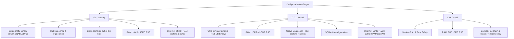

# 🚀 NetworkMeasureBox (NMB) — De-Pythonization Architecture Blueprint
## Migration Roadmap for Embedded Routers, OpenWrt & Resource-Constrained Hardware

---

## 1. Executive Summary & Problem Formulation

### 1.1 The Embedded Reality
NetworkMeasureBox (NMB) currently runs as a suite of Python 3 daemons (`nmb-probe`, `nmb-netd`, `nmb-speed`, `nmb-web`, `nmb-invasive-log`). While Python provides rapid development, rich standard libraries, and excellent developer ergonomics on x86 servers and Raspberry Pi 4/5 devices, it poses severe architectural bottlenecks when deployed on standard commercial routers, enterprise access points, and low-cost CPE (Customer Premises Equipment):

| Metric | Python 3 (Current) | Typical OpenWrt Router | Consequence / Failure Mode |
| :--- | :--- | :--- | :--- |
| **RAM Footprint (RSS)** | 35MB – 55MB per daemon (~160MB total) | 32MB – 128MB Total RAM | **Instant Kernel OOM Killer** |
| **Flash Storage** | 35MB – 60MB (Python runtime + `.pyc`) | 16MB – 32MB SPI Flash | **Does not fit in Flash** |
| **Startup Latency** | 1.8s – 3.5s per process | Instantaneous expected | Systemd/procd timeouts |
| **Jitter / Precision** | GIL & Garbage Collection jitter (1–10ms) | Sub-millisecond timing needed | Distorted latency & bufferbloat stats |
| **Subprocess Spawning** | High fork overhead (`ip`, `nmcli`, `sysctl`) | Slow MIPS/ARM CPU (400–800MHz) | 100% CPU spikes during interface scans |

### 1.2 Strategic Goal: The De-Pythonization Objective
The goal is to transition NetworkMeasureBox into a **zero-dependency, single static binary (`nmbd`)** that can run natively across any Linux device with as little as **16MB SPI flash and 32MB–64MB RAM**, while eliminating external runtime packages.

---

## 2. Technology Evaluation: Go (Golang) vs. C (C11) vs. C++ (C++17)

To achieve maximum portability with minimal friction, we evaluated three primary systems programming languages:



### 2.1 Detailed Comparison Matrix

| Technical Criterion | Python 3 (Current) | Go (Golang 1.23+) | C (C11 / musl libc) | C++ (C++17 / musl) |
| :--- | :--- | :--- | :--- | :--- |
| **Static Binary Size** | N/A (Interpreted) | 8MB – 12MB (3.2MB with UPX) | **450KB – 1.2MB** (280KB with UPX) | 1.2MB – 2.8MB |
| **Active RAM (RSS)** | 140MB – 220MB (5 daemons) | **10MB – 18MB** (all-in-one) | **1.8MB – 3.5MB** (all-in-one) | 3.5MB – 6MB |
| **Flash Budget Fit** | Requires USB/SD or >128MB Flash | Fits in 16MB+ Flash (UPX compressed) | **Fits easily in 8MB / 16MB SPI Flash** | Fits in 16MB+ Flash |
| **Cross-Compilation** | Complex (Python build per arch) | **Trivial** (`GOOS=linux GOARCH=mips`) | Requires SDK / `musl-cross-make` | Requires SDK / cross toolchains |
| **Concurrency Engine** | Asyncio + multi-threading + forks | **Goroutines** (2KB stack, channel IPC) | `epoll` + POSIX pthreads | `epoll` + `std::jthread` / ASIO |
| **Web Server & UI** | Python `http.server` | Built-in `net/http` + `//go:embed` | Embedded `mongoose.c` or `libmicrohttpd` | `CivetWeb` or `Crow` |
| **Database Engine** | `sqlite3` module | Pure Go SQLite (`modernc.org/sqlite`) | `sqlite3.c` amalgamation | `sqlite3.c` amalgamation |
| **Network Interfaces** | Subprocesses (`/sbin/ip`) | Native Netlink (`vishvananda/netlink`) | Native `rtnetlink` / `libnl-tiny` | Native `rtnetlink` / `libnl-tiny` |
| **Raw ICMP Ping** | Raw Python sockets | `golang.org/x/net/icmp` | POSIX `SOCK_RAW` / `IPPROTO_ICMP` | POSIX `SOCK_RAW` / `IPPROTO_ICMP` |

---

## 3. Recommended Architectural Decision

### 🎯 Two-Tier Tiered Strategy:
1. **Tier 1 (Go / Golang) — Primary Universal Target (64MB+ RAM)**:
   - Targets: Raspberry Pi (Zero, 2, 3, 4, 5), GL.iNet modern routers (Axt1800, Flint 2, Beryl AX), x86 appliances, Teltonika routers, all Linux distributions.
   - **Why Go**: Single static binary compilation (`CGO_ENABLED=0`), zero C toolchain cross-compilation headaches, memory safety, built-in high-performance HTTP server, and `//go:embed` which bakes the entire HTML/CSS/JS frontend directly into the executable.
2. **Tier 2 (C11 / musl) — Ultra-Constrained OpenWrt Target (16MB Flash / 32MB RAM)**:
   - Targets: Classic MIPS home routers (TP-Link Archer C7, Netgear WNDR, MediaTek MT7621, 32MB RAM devices).
   - **Why C**: Sub-2MB RAM footprint, single-file SQLite amalgamation, raw epoll event loop, direct rtnetlink kernel calls.

---

## 4. Component-by-Component Migration Blueprint

### 4.1 Latency, Jitter & Loss Probe Engine (`nmb-probe`)
- **Current Bottleneck**: Polling 5 targets every 500ms in Python uses ~15% CPU on low-end MIPS chips and consumes 35MB RAM.
- **Go Blueprint**:
  - Use `golang.org/x/net/icmp` with unprivileged UDP ICMP (`SOCK_DGRAM`) or raw ICMP.
  - Implement **Welford's algorithm** for running mean, variance, and jitter calculation in constant memory $\mathcal{O}(1)$:
    $$M_k = M_{k-1} + \frac{x_k - M_{k-1}}{k}, \quad S_k = S_{k-1} + (x_k - M_{k-1})(x_k - M_k)$$
  - Goroutine ticker flushes aggregate metrics to the SQLite WAL queue every 10 seconds.
- **C Blueprint**:
  - Single-threaded event loop using Linux `epoll` + `timerfd`.
  - Non-blocking ICMP echo requests sent to all targets concurrently.
  - Zero heap allocation during steady-state polling loop.

### 4.2 Dynamic Network & Route Daemon (`nmb-netd`)
- **Current Bottleneck**: Python periodically spawns `subprocess.run(["ip", ...])` and `nftables`, causing continuous process fork/exec overhead.
- **Go Blueprint**:
  - Open a Netlink socket via `github.com/vishvananda/netlink`.
  - Subscribe to kernel routing and interface events (`RTM_NEWLINK`, `RTM_DELLINK`, `RTM_NEWROUTE`).
  - Strict wired Ethernet priority: On link up/down, immediately adjust default route metric via netlink message without calling external binaries.
- **C Blueprint**:
  - Direct socket to kernel: `socket(AF_NETLINK, SOCK_RAW, NETLINK_ROUTE)`.
  - OpenWrt native integration: link against `libnl-tiny` (under 40KB in size).

### 4.3 High-Throughput Speedtest Engine (`nmb-speed`)
- **Current Bottleneck**: Python's GIL and socket overhead cannot sustain multi-gigabit throughput (1Gbps – 10Gbps) without 100% CPU saturation.
- **Go Blueprint**:
  - Multi-stream parallel HTTP/2 and HTTP/1.1 download worker pool (4–16 goroutines).
  - Explicit socket source binding via `net.Dialer.Control` applying `SO_BINDTODEVICE` or `IP_BIND_ADDRESS_NO_PORT` to enforce interface binding (wired Ethernet priority).
  - Native Ookla HTTP protocol, Cloudflare Speed protocol (`/cdn-cgi/trace` + chunk down/up), and RTR-Netztest RMBT protocol.
  - Concurrent background ICMP ping running during speedtest for real-time **Bufferbloat grade calculation**.

### 4.4 Web Server, REST API & Embedded Dashboard (`nmb-web`)
- **Current Bottleneck**: Python's `ThreadingHTTPServer` spawns OS threads per request and requires Python filesystem access.
- **Go Blueprint**:
  - Standard `net/http` server with HTTP/2 and keep-alive.
  - **Embedded Assets**: Use `//go:embed web/dist/*` to compile the entire dashboard HTML, JavaScript, CSS, and SVG icons directly into the `.rodata` section of the binary. No external web files need to be installed on disk!
  - Native HTTP Basic Auth with constant-time password comparison (`subtle.ConstantTimeCompare`).
  - Standard router HTTP port 80 out-of-the-box, with unprivileged automatic fallback to port 8080 if `EACCES` occurs.
- **C Blueprint**:
  - Embedded `mongoose.c` or `libmicrohttpd`.
  - Frontend HTML gzipped and compiled into a C byte array (`const unsigned char dashboard_html_gz[]`).

### 4.5 In-Memory Database & Persistence (`nmb-db`)
- **Current Bottleneck**: Periodic SQLite backup snapshots via Python stdlib.
- **Go Blueprint**:
  - Pure Go SQLite driver (`modernc.org/sqlite` or `github.com/glebarez/go-sqlite`).
  - **Zero CGO**: Compiles statically for `mips`, `mipsel`, `arm`, `arm64`, and `x86_64` without installing any C cross-compiler!
  - RAM database on `/run/nmb/live.db` (WAL mode enabled), synchronized to persistent flash storage `/var/lib/nmb/persist/nmb.db` every 15 minutes.

---

## 5. Architectural Proposal: The Unified Single-Binary Monolith (`nmbd`)

Instead of maintaining 5 distinct daemons with separate process overhead, the ultimate embedded architecture unifies all components into a single multi-call binary:

```
                          ┌───────────────────────────────────────┐
                          │   nmbd (Unified Single Static Binary) │
                          └───────────────────┬───────────────────┘
                                              │
              ┌───────────────────┬───────────┴───────────┬───────────────────┐
              ▼                   ▼                       ▼                   ▼
      ┌───────────────┐   ┌───────────────┐       ┌───────────────┐   ┌───────────────┐
      │  Engine: Netd │   │ Engine: Probe │       │ Engine: Speed │   │  Engine: Web  │
      │  (Netlink RX) │   │ (ICMP Ticker) │       │ (Multi-Stream)│   │  (Port 80 UI) │
      └───────┬───────┘   └───────┬───────┘       └───────┬───────┘   └───────┬───────┘
              │                   │                       │                   │
              └───────────────────┼───────────────────────┴───────────────────┘
                                  ▼
                      ┌───────────────────────┐
                      │ In-Memory Go Channels │
                      │  (Lock-free Telemetry)│
                      └───────────┬───────────┘
                                  ▼
                      ┌───────────────────────┐
                      │ Embedded SQLite (RAM) │
                      │  (/run/nmb/live.db)   │
                      └───────────────────────┘
```

### Multi-Call CLI Compatibility (Busybox-style):
Symlinking the binary allows full backwards compatibility with existing systemd/OpenRC units:
- `/usr/local/bin/nmb-probe` $\to$ `/usr/local/bin/nmbd --mode probe`
- `/usr/local/bin/nmb-speed` $\to$ `/usr/local/bin/nmbd --mode speed`
- `/usr/local/bin/nmb-netd`  $\to$ `/usr/local/bin/nmbd --mode netd`
- `/usr/local/bin/nmb-web`   $\to$ `/usr/local/bin/nmbd --mode web`

---

## 6. Three-Phase Hybrid Migration Roadmap

To avoid disruption to existing installations, the migration follows a phased hybrid approach:

```mermaid
timeline
    title NetworkMeasureBox De-Pythonization Phases
    section Phase 1 : Micro-Engines
        Go/C ICMP Probe Engine : Drops 90% CPU & 40MB RAM
        Go Multi-Stream Speed Runner : Enables 1Gbps-10Gbps line-rate testing
    section Phase 2 : Netlink & Route
        Go/C Netlink Daemon : Replaces subprocess calls to ip/nmcli
        Strict Wired Route Prioritizer : Sub-millisecond route metric switching
    section Phase 3 : Single Binary
        Unified nmbd Binary : Zero Python dependencies
        OpenWrt .ipk Package : Official feed distribution for home routers
```

### Phase 1: High-ROI Micro-Engine Replacements
- **Step 1.1**: Build `nmb-probe` in Go (`cmd/nmb-probe/main.go`). It communicates with the existing Python `nmb-web` and SQLite database directly through `/var/lib/nmb/live/nmb.db`.
- **Step 1.2**: Build `nmb-speed` in Go (`cmd/nmb-speed/main.go`). Slashes speedtest CPU overhead and handles high-speed fiber lines.

### Phase 2: Netlink & Route Daemon
- **Step 2.1**: Implement native Netlink interface monitor in Go, eliminating shell invocations of `/sbin/ip` and `/sbin/ethtool`.
- **Step 2.2**: Integrate real-time carrier detection and wired interface metric enforcement (metric 50).

### Phase 3: Consolidated Monolith (`nmbd`) & OpenWrt Package
- **Step 3.1**: Embed the web UI assets and compile `nmbd`.
- **Step 3.2**: Produce official OpenWrt package Makefile (`nmb.ipk`) with a procd init script, allowing one-click installation via `opkg install nmb`.

---

## 7. Cross-Compilation Matrix (Go)

Compiling for any embedded architecture requires zero external cross-compilers using Go:

```bash
# 1. Raspberry Pi 4 / 5 & Modern 64-bit ARM Routers (aarch64)
CGO_ENABLED=0 GOOS=linux GOARCH=arm64 go build -ldflags="-s -w" -o dist/nmbd-arm64 ./cmd/nmbd

# 2. Raspberry Pi 2 / 3 & 32-bit ARMv7 Routers (armhf)
CGO_ENABLED=0 GOOS=linux GOARCH=arm GOARM=7 go build -ldflags="-s -w" -o dist/nmbd-armhf ./cmd/nmbd

# 3. Raspberry Pi 1 / Zero (ARMv6)
CGO_ENABLED=0 GOOS=linux GOARCH=arm GOARM=6 go build -ldflags="-s -w" -o dist/nmbd-armel ./cmd/nmbd

# 4. Classic OpenWrt Routers (MIPS Big-Endian, Soft-Float)
CGO_ENABLED=0 GOOS=linux GOARCH=mips GOMIPS=softfloat go build -ldflags="-s -w" -o dist/nmbd-mips ./cmd/nmbd

# 5. MediaTek MT7621 / MT7628 Routers (MIPS Little-Endian, Soft-Float)
CGO_ENABLED=0 GOOS=linux GOARCH=mipsle GOMIPS=softfloat go build -ldflags="-s -w" -o dist/nmbd-mipsle ./cmd/nmbd

# 6. x86_64 Appliances & Mini-PCs
CGO_ENABLED=0 GOOS=linux GOARCH=amd64 go build -ldflags="-s -w" -o dist/nmbd-amd64 ./cmd/nmbd
```

---

## 8. Conclusion
By executing this De-Pythonization roadmap, NetworkMeasureBox will transform from a Python-dependent SBC application into an **industrial-grade, single-binary network appliance** capable of running on virtually any router in existence—from a 16MB flash OpenWrt box to a 10G enterprise server—with minimal memory footprint, zero dependencies, and router-native port 80 accessibility.
